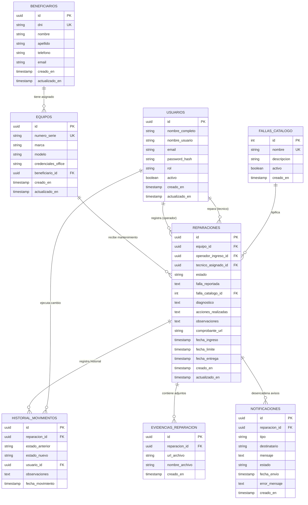
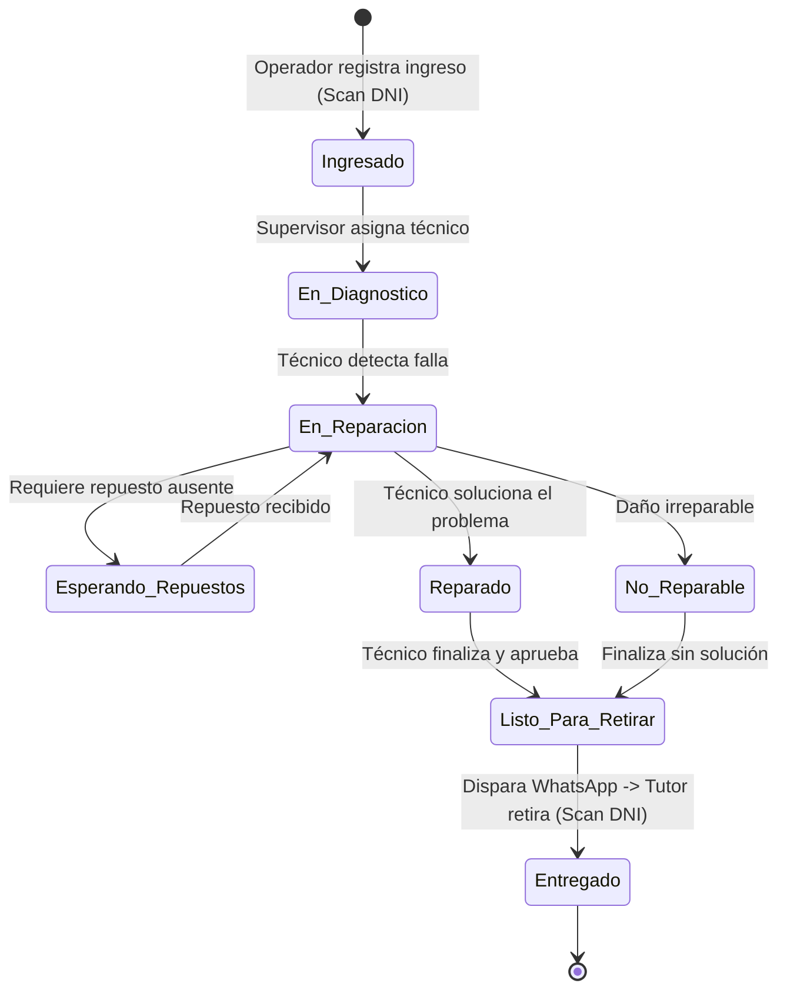
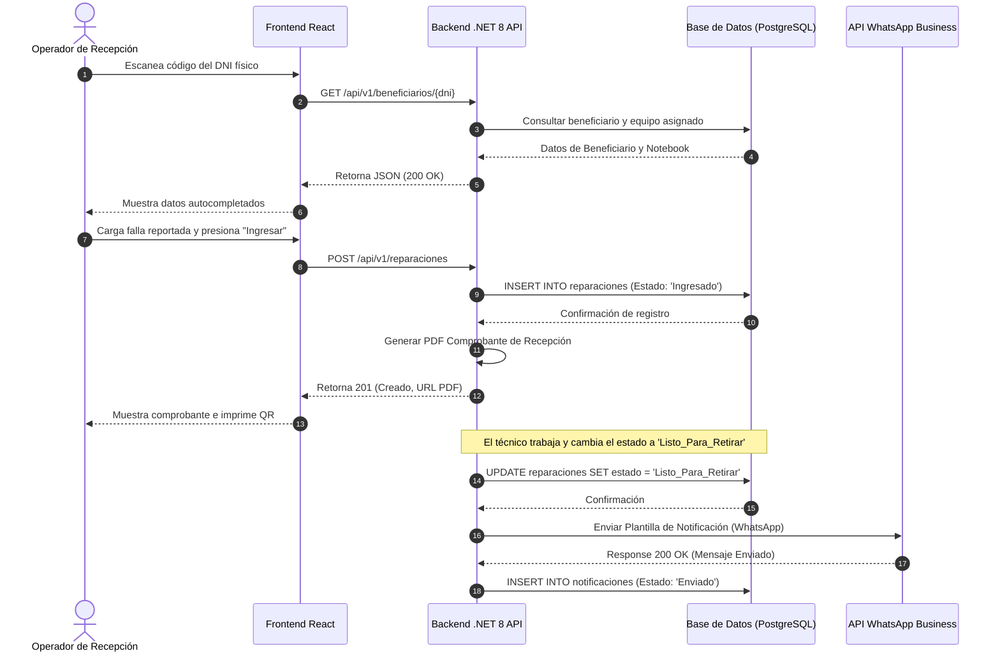
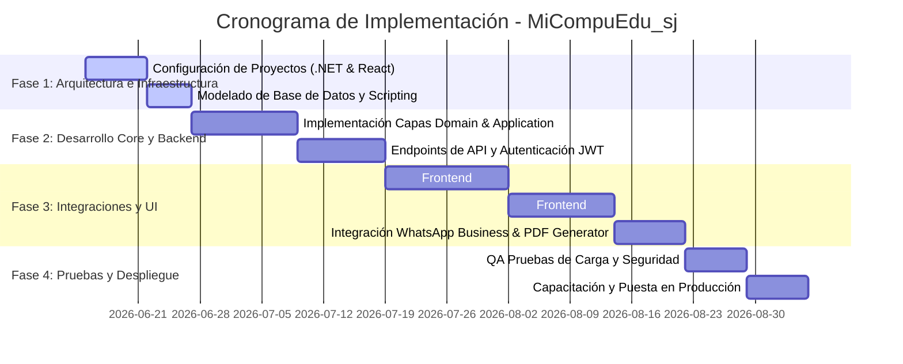

# DISEÑO E IMPLEMENTACIÓN DEL SISTEMA DE GESTIÓN Y TRAZABILIDAD DE DISPOSITIVOS EDUCATIVOS (MiCompuEdu_sj)
## Caso de Estudio: Depósito del Ministerio de Educación de San Juan

---

## 1. INTRODUCCIÓN Y CONTEXTO

El Ministerio de Educación de la Provincia de San Juan administra miles de dispositivos tecnológicos (notebooks de los programas "Conectar Igualdad", "Juana Manso", entre otros) asignados a estudiantes y docentes de toda la provincia. 

### 1.1. Problemática Actual
Actualmente, el proceso de recepción, diagnóstico, reparación y entrega de estos equipos en el depósito central es ineficiente y propenso a fallas debido a su naturaleza manual:
1. **Registro Manual**: El operador utiliza planillas de papel para registrar los datos del beneficiario y del equipo, lo que genera errores de tipeo e ilegibilidad.
2. **Falta de Trazabilidad**: No existe un historial de reparaciones ni se puede conocer en tiempo real en qué estado de reparación (ej. "En diagnóstico", "Esperando repuestos") se encuentra un equipo.
3. **Pérdida de Información**: Al no estar validada la información contra un padrón centralizado, se registran números de serie incorrectos, nombres erróneos y teléfonos obsoletos.
4. **Fallas de Comunicación**: Las notificaciones de retiro de equipos se realizan mediante llamadas telefónicas manuales. Si el número anotado es incorrecto o no contestan, el equipo permanece archivado de forma indefinida, congestionando el depósito.

### 1.2. Solución Propuesta (MiCompuEdu_sj)
Se propone el desarrollo de un sistema web integral y responsivo que automatice el flujo de trabajo mediante:
* Registro asistido por escaneo del código de barras de los DNI.
* Integración en tiempo real con la base de datos nominal de beneficiarios del Ministerio.
* Gestión digital de las reparaciones con asignación de técnicos y cambio de estados.
* Trazabilidad completa e inmutable de los movimientos.
* Notificaciones automatizadas mediante la integración con la API de WhatsApp Business.
* Generación de comprobantes digitales de recepción y entrega en PDF.

---

## 2. ESPECIFICACIÓN DE REQUERIMIENTOS

### 2.1. Requerimientos Funcionales (RF)

| ID | Nombre | Descripción | Prioridad |
|---|---|---|---|
| **RF-01** | Búsqueda por Escaneo de DNI | El sistema debe permitir la lectura del código de barras (PDF417) del DNI físico del beneficiario/tutor mediante lector de código de barras USB/cámara, extrayendo el DNI para realizar la búsqueda automática. | Alta |
| **RF-02** | Consulta de Padrón Nominal | El sistema debe consultar la base de datos centralizada del Ministerio de Educación usando el DNI para recuperar los datos personales (Nombre, Apellido, Teléfono, Correo) y la notebook asignada (Marca, Modelo, Número de Serie, Credenciales). | Alta |
| **RF-03** | Registro de Ingreso | El operador debe poder registrar el ingreso del dispositivo cargando la falla reportada (desde un catálogo predefinido o descripción libre) y confirmando los datos del tutor. | Alta |
| **RF-04** | Generación de Comprobante PDF | Al confirmar el ingreso, el sistema debe generar un comprobante digital en formato PDF con un código QR único para que el beneficiario descargue el estado de su equipo. | Alta |
| **RF-05** | Asignación de Técnico | El supervisor o el sistema automáticamente debe poder asignar un equipo ingresado a un técnico disponible para su diagnóstico y reparación. | Media |
| **RF-06** | Registro de Diagnóstico y Acciones | El técnico asignado debe poder registrar el diagnóstico del equipo, las acciones correctivas tomadas, y seleccionar la falla real del catálogo. | Alta |
| **RF-07** | Control de Cambios de Estado | El sistema debe permitir transicionar el equipo por los estados definidos: *Ingresado, En diagnóstico, En reparación, Esperando repuestos, Reparado, Listo para retirar, Entregado, No reparable*. | Alta |
| **RF-08** | Adjuntar Evidencia Multimedia | El técnico debe poder cargar fotos o archivos (hasta 5MB) de la falla física o de la reparación finalizada (ej. placa quemada, pantalla rota). | Media |
| **RF-09** | Notificaciones por WhatsApp | Al transicionar el estado del equipo a "Listo para retirar" o "No reparable", el sistema debe disparar automáticamente un mensaje de WhatsApp al tutor usando una plantilla de WhatsApp Business API. | Alta |
| **RF-10** | Trazabilidad e Historial | El sistema debe registrar un historial inmutable de cada movimiento de estado de la notebook, registrando: fecha/hora, usuario responsable, estado anterior, estado nuevo y observaciones. | Alta |
| **RF-11** | Panel de Estadísticas (Dashboard) | El sistema debe proveer al supervisor un panel visual con indicadores clave: equipos pendientes, tiempos promedios de reparación, fallas más recurrentes y rendimiento de técnicos. | Media |
| **RF-12** | Catálogo de Fallas | El supervisor debe poder gestionar (Crear, Editar, Desactivar) el catálogo de fallas del sistema para estandarizar los diagnósticos. | Media |
| **RF-13** | Gestión de Usuarios y Roles | El administrador debe poder crear, editar y dar de baja usuarios, asignándoles uno de los 4 roles definidos (*Administrador, Supervisor, Técnico, Operador*). | Alta |
| **RF-14** | Auditoría del Sistema | El sistema debe registrar un log de auditoría interna de acciones críticas (inicios de sesión, cambios de configuraciones, eliminación de datos). | Media |
| **RF-15** | Registro de Entrega | El operador debe registrar la entrega física del equipo al tutor, solicitando la validación del DNI y marcando el equipo como "Entregado", lo cual archiva la reparación activa. | Alta |

### 2.2. Requerimientos No Funcionales (RNF)

| ID | Categoría | Descripción | Métrica / Indicador |
|---|---|---|---|
| **RNF-01** | Arquitectura | El backend debe desarrollarse en .NET 8 utilizando el patrón de diseño Clean Architecture para mantener separación de responsabilidades. | Código fuente estructurado en capas. |
| **RNF-02** | Base de Datos | La base de datos debe ser PostgreSQL v15 o superior, con llaves foráneas e índices para garantizar integridad y rapidez. | Tiempo de respuesta de consultas en BD < 100ms. |
| **RNF-03** | Frontend | La interfaz web debe desarrollarse con React (Vite) + TypeScript y estilizarse mediante Tailwind CSS con diseño "Mobile-First". | Adaptabilidad en celulares, tablets y PCs (100% responsivo). |
| **RNF-04** | Seguridad | El control de accesos debe ser mediante JSON Web Tokens (JWT) firmados, con un tiempo de expiración de 8 horas. | Tokens encriptados vía HS256 transmitidos por HTTPS. |
| **RNF-05** | Disponibilidad | La plataforma debe estar operativa y accesible para los usuarios autorizados durante la jornada laboral. | Disponibilidad del 99.5% (SLA). |
| **RNF-06** | Rendimiento | El tiempo de respuesta de los endpoints principales de la API no debe superar los 300ms bajo condiciones normales de carga. | Pruebas de carga con 50 usuarios concurrentes. |
| **RNF-07** | Resiliencia de Red | El frontend debe almacenar localmente datos temporales del escaneo de DNI si hay una micro-caída de la red, para evitar re-escaneos. | Uso de `localStorage`/`sessionStorage` en el cliente. |
| **RNF-08** | Concurrencia | El sistema debe manejar concurrencia optimista al actualizar registros de equipos para evitar que dos técnicos sobrescriban un diagnóstico al mismo tiempo. | Implementación de `RowVersion` o campos de timestamp en EF Core. |
| **RNF-09** | Escalabilidad | La API debe diseñarse sin estado (Stateless) para posibilitar el escalado horizontal mediante contenedores Docker en el servidor del Ministerio. | Despliegue en Kubernetes o Docker Swarm sin sesión pegajosa. |
| **RNF-10** | Mantenibilidad | El código de la capa de aplicación debe tener pruebas unitarias automatizadas para verificar las reglas de negocio principales. | Cobertura de tests unitarios mínima del 70% en la capa Application. |

---

## 3. DISEÑO FUNCIONAL: HISTORIAS DE USUARIO Y CASOS DE USO

### 3.1. Historias de Usuario (US)

#### US-01: Escaneo de DNI y Búsqueda Automática
* **Como** Operador de Recepción  
* **Quiero** escanear el DNI físico del beneficiario o su tutor  
* **Para** que el sistema autocomplete los datos personales y recupere el dispositivo asignado sin tener que escribir manualmente.  
* **Criterios de Aceptación**:  
  * **Dado** que el cursor está en el campo de búsqueda de DNI.  
  * **Cuando** se escanea el código PDF417 del DNI físico.  
  * **Entonces** el sistema debe decodificar el número de documento y realizar la consulta automática al padrón del Ministerio.  
  * **Dado** que el DNI no existe en el padrón.  
  * **Cuando** se realiza la búsqueda.  
  * **Entonces** el sistema debe mostrar una alerta permitiendo la carga manual de emergencia del tutor y del equipo.

#### US-02: Registro de Falla e Ingreso de Notebook
* **Como** Operador de Recepción  
* **Quiero** registrar la falla reportada del equipo y generar el ingreso en el sistema  
* **Para** formalizar el inicio del proceso de soporte técnico.  
* **Criterios de Aceptación**:  
  * **Dado** que se ha seleccionado un beneficiario y su equipo.  
  * **Cuando** el operador selecciona una falla común del catálogo, detalla observaciones físicas y presiona "Registrar Ingreso".  
  * **Entonces** se crea una nueva orden de reparación en estado "Ingresado" y se descuenta el stock de repuestos virtuales (si aplica).

#### US-03: Emisión de Comprobante PDF con QR
* **Como** Operador de Recepción  
* **Quiero** descargar o imprimir un comprobante en PDF  
* **Para** entregárselo al tutor como constancia física y digital de recepción.  
* **Criterios de Aceptación**:  
  * **Dado** que una orden de ingreso ha sido guardada exitosamente.  
  * **Cuando** el sistema procesa el registro.  
  * **Entonces** se debe generar un PDF con: datos del tutor, número de serie de la notebook, fecha/hora de ingreso, firma del operador y un código QR que apunta a la URL pública de consulta de estado del equipo.

#### US-04: Asignación de Órdenes de Reparación
* **Como** Supervisor  
* **Quiero** asignar órdenes de reparación a técnicos específicos  
* **Para** balancear la carga de trabajo y asegurar que cada equipo tenga un técnico responsable.  
* **Criterios de Aceptación**:  
  * **Dado** una lista de equipos en estado "Ingresado".  
  * **Cuando** el supervisor selecciona un equipo y escoge un técnico de la lista de usuarios con rol "Tecnico".  
  * **Entonces** el sistema cambia el estado a "En diagnóstico" y envía una alerta visual al panel del técnico asignado.

#### US-05: Registro de Diagnóstico y Reparación
* **Como** Técnico  
* **Quiero** registrar el diagnóstico técnico detallado y las acciones que realicé en el equipo  
* **Para** documentar formalmente la solución técnica aplicada.  
* **Criterios de Aceptación**:  
  * **Dado** que tengo asignado un equipo en estado "En diagnóstico" o "En reparación".  
  * **Cuando** completo los campos "Diagnóstico", "Acciones Realizadas", selecciono la falla real y presiono "Guardar Diagnóstico".  
  * **Entonces** la base de datos almacena el texto e inhabilita su modificación si el estado pasa a "Reparado".

#### US-06: Carga de Evidencia Multimedia
* **Como** Técnico  
* **Quiero** adjuntar imágenes de la placa base o componentes dañados  
* **Para** justificar repuestos solicitados o respaldar el diagnóstico de "No reparable".  
* **Criterios de Aceptación**:  
  * **Dado** que estoy editando una orden de reparación.  
  * **Cuando** arrastro un archivo de imagen (.jpg, .png) al área de carga y presiono guardar.  
  * **Entonces** el archivo se sube al almacenamiento del servidor y se muestra una vista previa en miniatura dentro del historial del equipo.

#### US-07: Notificación Automática por WhatsApp
* **Como** Supervisor / Sistema  
* **Quiero** que el sistema envíe un mensaje automático de WhatsApp al tutor cuando el equipo esté listo  
* **Para** reducir el tiempo muerto de los equipos en el depósito y evitar llamadas telefónicas fallidas.  
* **Criterios de Aceptación**:  
  * **Dado** que el técnico cambia el estado de una reparación de "En reparación" a "Listo para retirar".  
  * **Cuando** se confirma la transacción.  
  * **Entonces** el sistema consume la API de WhatsApp, enviando un mensaje predefinido con el nombre del tutor, número de serie y la dirección del depósito. El estado del envío debe registrarse como "Enviado" en la tabla `notificaciones`.

#### US-08: Trazabilidad del Dispositivo
* **Como** Supervisor  
* **Quiero** ver la línea de tiempo histórica de movimientos de una notebook específica  
* **Para** auditar quién manipuló el equipo, cuándo cambió de estado y qué observaciones se hicieron.  
* **Criterios de Aceptación**:  
  * **Dado** que consulto el detalle de un equipo.  
  * **Cuando** navego a la pestaña de "Historial".  
  * **Entonces** el sistema muestra una lista cronológica descendente de todos los cambios de estado con el nombre del usuario que realizó la acción, la fecha/hora exacta y las observaciones de cada cambio.

#### US-09: Dashboard de Gestión y Rendimiento
* **Como** Supervisor  
* **Quiero** visualizar gráficos estadísticos de los equipos en el depósito  
* **Para** tomar decisiones sobre la compra de repuestos y evaluar la eficiencia del servicio.  
* **Criterios de Aceptación**:  
  * **Dado** que accedo a la pantalla principal de Supervisor.  
  * **Cuando** el dashboard carga.  
  * **Entonces** se muestran tarjetas métricas (total ingresados, pendientes, entregados), un gráfico de barras con las 5 fallas más comunes y el indicador del tiempo promedio de resolución de los equipos (días entre ingreso y listo para retirar).

#### US-10: Configuración de la API de Notificaciones
* **Como** Administrador  
* **Quiero** configurar las credenciales y el endpoint de la API de WhatsApp Business  
* **Para** asegurar la continuidad del servicio de mensajería automatizada ante cambios de proveedor.  
* **Criterios de Aceptación**:  
  * **Dado** que accedo a la sección de Configuración de Sistema.  
  * **Cuando** ingreso la URL de la API, el Token de acceso Bearer, el ID del número de teléfono y presiono "Guardar y Probar".  
  * **Entonces** el sistema realiza un envío de prueba al teléfono del administrador para validar la conectividad antes de guardar los datos de configuración de manera encriptada.

---

### 3.2. Diagrama de Casos de Uso (Mermaid)

```mermaid
fcg [Diagrama de Casos de Uso - MiCompuEdu_sj]
left to right direction

actor Operador as "Operador de Recepción"
actor Tecnico as "Técnico"
actor Supervisor as "Supervisor"
actor Administrador as "Administrador"

rectangle Sistema_MiCompuEdu {
  (Escanear DNI e Ingresar Equipo) as UC1
  (Imprimir Comprobante PDF) as UC2
  (Registrar Diagnóstico y Reparación) as UC3
  (Cargar Fotos de Evidencia) as UC4
  (Asignar Órdenes de Trabajo) as UC5
  (Gestionar Catálogo de Fallas) as UC6
  (Ver Dashboard Estadístico) as UC7
  (Gestionar Usuarios y Permisos) as UC8
  (Configurar WhatsApp Business API) as UC9
  (Registrar Entrega de Notebook) as UC10
}

Operador --> UC1
Operador --> UC2
Operador --> UC10

Tecnico --> UC3
Tecnico --> UC4

Supervisor --> UC5
Supervisor --> UC6
Supervisor --> UC7
Supervisor --> UC3

Administrador --> UC8
Administrador --> UC9
```

#### Caso de Uso Detallado: Registrar Ingreso de Notebook (UC1)
* **Actor Principal**: Operador de Recepción.
* **Precondiciones**: El usuario operador se encuentra autenticado en el sistema y cuenta con el lector de DNI conectado.
* **Flujo Principal**:
  1. El operador hace clic en "Registrar Ingreso".
  2. El operador posiciona el cursor en el campo de búsqueda rápida y escanea el código PDF417 del DNI del beneficiario.
  3. El sistema extrae el número de DNI del string decodificado.
  4. El sistema busca en el Padrón del Ministerio y recupera los datos del tutor y de la notebook asignada.
  5. El sistema rellena automáticamente la pantalla con los datos recuperados.
  6. El operador valida visualmente la información con el ciudadano y selecciona la "Falla Reportada" del catálogo y describe los detalles observados del equipo.
  7. El operador presiona "Confirmar Ingreso".
  8. El sistema guarda la reparación en la base de datos con estado "Ingresado", genera el PDF de recepción y actualiza el historial del dispositivo.
* **Flujo Alternativo (4a - No existe en padrón)**:
  1. Si el DNI no arroja resultados, el sistema avisa al operador.
  2. El operador procede a rellenar manualmente los campos del Tutor (DNI, Nombre, Apellido, Celular, Email) y del Dispositivo (Marca, Modelo, Número de Serie).
  3. Continúa en el paso 6.
* **Postcondiciones**: La notebook queda en estado "Ingresado" y se habilita la descarga de su comprobante.

---

## 4. DISEÑO DE DATOS: MODELO ENTIDAD RELACIÓN (DER)



---

## 5. ARQUITECTURA DEL SOFTWARE: CLEAN ARCHITECTURE

El backend está diseñado utilizando los principios de **Clean Architecture** (Arquitectura Limpia) propuestos por Robert C. Martin, organizada en proyectos independientes para desacoplar el dominio del negocio de las bases de datos y de la interfaz de usuario.

```
+-------------------------------------------------------------+
| Presentation / Web API (.NET 8 Controllers)                 |
|   +---------------------------------------------------------+
|   | Infrastructure (EF Core, PostgreSQL, WhatsApp API)      |
|   |   +-----------------------------------------------------+
|   |   | Application (CQRS: MediatR Commands/Queries, DTOs)   |
|   |   |   +-------------------------------------------------+
|   |   |   | Domain (Core: Entities, Value Objects, Enums)   |
|   |   |   +-------------------------------------------------+
|   |   +-----------------------------------------------------+
|   +---------------------------------------------------------+
+-------------------------------------------------------------+
```

### 5.1. Capas del Sistema

1. **Domain (Núcleo)**:
   - Contiene la lógica empresarial pura.
   - Entidades principales (`Usuario`, `Beneficiario`, `Equipo`, `Reparacion`), Enumeraciones (`EstadoEquipo`, `UserRole`) y Excepciones de dominio.
   - No tiene ninguna dependencia con librerías externas o bases de datos (0 dependencias externas).
2. **Application (Capa de Casos de Uso)**:
   - Contiene los flujos de trabajo de la aplicación y la orquestación del sistema.
   - Implementa el patrón **CQRS** (Command Query Responsibility Segregation) utilizando la librería **MediatR**.
   - Contiene la definición de las interfaces de infraestructura (ej: `IApplicationDbContext`, `IWhatsAppService`, `IPdfGenerator`).
   - Define los DTOs para la transferencia de datos y validadores (`FluentValidation`).
3. **Infrastructure (Capa de Implementación)**:
   - Implementa los contratos definidos en la capa de Aplicación.
   - Acceso a base de datos mediante **Entity Framework Core (EF Core)** configurando el contexto de base de datos (`ApplicationDbContext`) para PostgreSQL.
   - Clientes externos HTTP para consumir APIs externas (ej. WhatsApp Business API).
   - Generación de archivos físicos (PDF con `QuestPDF` o `IronPDF`).
4. **Presentation / Web API (Capa Externa)**:
   - Expone los endpoints HTTP a través de controladores REST (`Web API Controllers`).
   - Maneja la autenticación y autorización mediante atributos `[Authorize]` con políticas basadas en roles.
   - Gestión global de excepciones con middleware personalizado para devolver respuestas uniformes de error (ej: RFC 7807 Problem Details).

---

## 6. ESTRUCTURA DE CARPETAS DEL PROYECTO (.NET 8 + REACT)

```
MiCompuEdu_sj/
├── backend/
│   ├── MiCompuEdu.Domain/
│   │   ├── Entities/
│   │   │   ├── Beneficiario.cs
│   │   │   ├── Equipo.cs
│   │   │   ├── Reparacion.cs
│   │   │   └── Usuario.cs
│   │   ├── Enums/
│   │   │   ├── EstadoEquipo.cs
│   │   │   └── UserRole.cs
│   │   └── Common/
│   │       └── BaseEntity.cs
│   │
│   ├── MiCompuEdu.Application/
│   │   ├── Common/
│   │   │   ├── Interfaces/
│   │   │   │   ├── IApplicationDbContext.cs
│   │   │   │   └── IWhatsAppService.cs
│   │   │   └── Exceptions/
│   │   ├── DTOs/
│   │   │   ├── BeneficiarioDto.cs
│   │   │   ├── EquipoDto.cs
│   │   │   ├── ReparacionDto.cs
│   │   │   └── LoginResponseDto.cs
│   │   ├── Reparaciones/
│   │   │   ├── Commands/
│   │   │   │   ├── RegistrarIngresoCommand.cs
│   │   │   │   └── ActualizarEstadoCommand.cs
│   │   │   └── Queries/
│   │   │       ├── GetReparacionByIdQuery.cs
│   │   │       └── GetReparacionesDashboardQuery.cs
│   │   └── Validators/
│   │
│   ├── MiCompuEdu.Infrastructure/
│   │   ├── Persistence/
│   │   │   ├── ApplicationDbContext.cs
│   │   │   ├── Migrations/
│   │   │   └── Configurations/
│   │   ├── Services/
│   │   │   ├── WhatsAppService.cs
│   │   │   └── PdfGeneratorService.cs
│   │   └── Identity/
│   │
│   └── MiCompuEdu.WebApi/
│       ├── Controllers/
│       │   ├── AuthController.cs
│       │   ├── ReparacionesController.cs
│       │   ├── BeneficiariosController.cs
│       │   └── DashboardController.cs
│       ├── Middlewares/
│       │   └── GlobalExceptionMiddleware.cs
│       ├── Program.cs
│       └── appsettings.json
│
├── frontend/
│   ├── public/
│   ├── src/
│   │   ├── assets/
│   │   ├── components/
│   │   │   ├── UI/
│   │   │   │   ├── Button.tsx
│   │   │   │   ├── Input.tsx
│   │   │   │   └── Badge.tsx
│   │   │   ├── Shared/
│   │   │   │   ├── Header.tsx
│   │   │   │   └── Sidebar.tsx
│   │   │   └── Scanner/
│   │   │       └── DniScanner.tsx
│   │   ├── hooks/
│   │   ├── pages/
│   │   │   ├── Login.tsx
│   │   │   ├── Operator/
│   │   │   │   ├── RegistrarIngreso.tsx
│   │   │   │   └── EntregaNotebook.tsx
│   │   │   ├── Technician/
│   │   │   │   └── PanelTecnico.tsx
│   │   │   └── Supervisor/
│   │   │       ├── Dashboard.tsx
│   │   │       └── CatalogoFallas.tsx
│   │   ├── services/
│   │   │   ├── api.ts
│   │   │   └── auth.ts
│   │   ├── store/
│   │   ├── App.tsx
│   │   ├── index.css
│   │   └── main.tsx
│   ├── tailwind.config.js
│   ├── vite.config.ts
│   └── package.json
```

---

## 7. CATÁLOGO DE ENDPOINTS REST (API RESTFUL)

Todos los endpoints REST utilizan respuestas en formato JSON. Las rutas de la API están prefijadas con `/api/v1`.

### 7.1. Módulo de Autenticación (`/api/v1/auth`)

* **POST `/login`**
  - **Descripción**: Permite el ingreso de usuarios (Operador, Técnico, Supervisor, Administrador). Retorna el JWT token y datos del usuario.
  - **Acceso**: Público.
  - **Request Body**:
    ```json
    { "nombreUsuario": "operador1", "password": "Password123!" }
    ```
  - **Response (200 OK)**:
    ```json
    { "token": "ey...", "nombre": "Operador Uno", "rol": "Operador", "email": "operador1@sanjuan.edu.ar" }
    ```

### 7.2. Módulo de Beneficiarios y Equipos (`/api/v1/beneficiarios`)

* **GET `/{dni}`**
  - **Descripción**: Recupera la información nominal del beneficiario y su notebook asignada buscando por número de DNI.
  - **Acceso**: Operador, Supervisor, Administrador.
  - **Response (200 OK)**:
    ```json
    {
      "id": "e6a00a12-8e7c-47bc-8f4b-01c56f8f5379",
      "dni": "42345678",
      "nombre": "Juan",
      "apellido": "Pérez",
      "telefono": "+542644123456",
      "email": "juanperez@gmail.com",
      "equipo": {
        "id": "b3e9a112-9c1a-4d22-b5e1-0c58e452174c",
        "numeroSerie": "SERIE12345678X",
        "marca": "Exo",
        "modelo": "Juana Manso v2",
        "credencialesOffice": "juan.perez.sj / passOffice2026"
      }
    }
    ```
  - **Response (404 Not Found)**:
    ```json
    { "title": "Not Found", "status": 404, "detail": "Beneficiario no encontrado en el padrón nominal." }
    ```

### 7.3. Módulo de Reparaciones (`/api/v1/reparaciones`)

* **POST `/`**
  - **Descripción**: Registra el ingreso de una notebook al depósito. Genera la orden inicial en estado "Ingresado".
  - **Acceso**: Operador, Supervisor.
  - **Request Body**:
    ```json
    {
      "equipoId": "b3e9a112-9c1a-4d22-b5e1-0c58e452174c",
      "fallaReportada": "El equipo se apaga luego de 5 minutos de uso continuo.",
      "fallaCatalogoId": 6,
      "observaciones": "Presenta rayones en la tapa superior."
    }
    ```
  - **Response (201 Created)**:
    ```json
    { "reparacionId": "f90df46a-7a56-42fb-a70d-f06b4b4eb461", "comprobanteUrl": "https://storage.sanjuan.edu.ar/pdf/rec-49823.pdf", "estado": "Ingresado" }
    ```

* **GET `/`**
  - **Descripción**: Obtiene la lista paginada y filtrable de todas las reparaciones (por estado, técnico, fecha o término de búsqueda).
  - **Acceso**: Operador, Técnico, Supervisor.
  - **Response (200 OK)**:
    ```json
    {
      "data": [
        { "reparacionId": "f90df46a-...", "numeroSerie": "SERIE123", "tutor": "Juan Pérez", "estado": "Ingresado", "fechaIngreso": "2026-06-13T07:45:00Z" }
      ],
      "totalRecords": 150,
      "page": 1,
      "pageSize": 10
    }
    ```

* **PUT `/{id}/estado`**
  - **Descripción**: Actualiza el estado de la reparación (conlleva logs automáticos y disparador de notificaciones por WhatsApp en caso de cambio a "Listo para retirar").
  - **Acceso**: Técnico, Supervisor, Administrador.
  - **Request Body**:
    ```json
    {
      "nuevoEstado": "Listo_Para_Retirar",
      "observaciones": "Se procedió al cambio de placa madre. Bios actualizada y testeada exitosamente.",
      "accionesRealizadas": "Reemplazo de Motherboard y carga de SO Huayra."
    }
    ```
  - **Response (200 OK)**:
    ```json
    { "success": true, "mensaje": "Estado actualizado correctamente. Notificación por WhatsApp encolada." }
    ```

---

## 8. DIAGRAMAS DE FLUJO Y SECUENCIA (FLUJO COMPLETO)

### 8.1. Diagrama de Actividades: Flujo del Ciclo de Vida del Dispositivo



### 8.2. Diagrama de Secuencia: Flujo de Ingreso y Notificación



---

## 9. DISEÑO DE INTERFAZ DE USUARIO: WIREFRAMES

A continuación se presentan bosquejos conceptuales en modo texto de la interfaz para guiar el desarrollo del frontend en React.

### 9.1. Wireframe 1: Registro de Ingreso (Operador)
```
+--------------------------------------------------------------------------------+
|  MiCompuEdu SJ  [Operador]                              [Usuario: operador1]  |
+--------------------------------------------------------------------------------+
|  [Ingresos]  [Entregas]  [Consulta Rápida]                                     |
+--------------------------------------------------------------------------------+
|                                                                                |
|  REGISTRAR INGRESO DE DISPOSITIVO                                              |
|  +--------------------------------------------------------------------------+  |
|  |  Escanear DNI o Ingresar Manualmente                                     |  |
|  |  [ DNI: 42345678                     ]   [ Buscar en Padrón (Enter) ]   |  |
|  +--------------------------------------------------------------------------+  |
|                                                                                |
|  DATOS DEL TUTOR/BENEFICIARIO            DATOS DEL EQUIPO (NOTEPAD)            |
|  +------------------------------------+  +----------------------------------+  |
|  | Nombre: Juan Pérez                 |  | Nro Serie: SERIE12345678X        |  |
|  | Teléfono: +54 264 4123456          |  | Marca / Modelo: Exo / Juana Manso|  |
|  | Email: juanperez@gmail.com         |  | Creds. Office: juan.perez.sj     |  |
|  +------------------------------------+  +----------------------------------+  |
|                                                                                |
|  DETALLE DEL INGRESO Y FALLA                                                   |
|  +--------------------------------------------------------------------------+  |
|  | Falla Tipo: [ Bloqueo de Seguridad (Juana Manso)                     [v] ]|  |
|  | Falla Reportada (Descripción del tutor):                                 |  |
|  | [ El equipo muestra pantalla roja de bloqueo escolar y no arranca...    ] |  |
|  | Observaciones Estéticas (Rayones, golpes, cargador incluido, etc.):      |  |
|  | [ Trae cargador original. Bisagra izquierda floja.                      ] |  |
|  +--------------------------------------------------------------------------+  |
|                                                                                |
|                      [ Cancelar ]            [ REGISTRAR INGRESO (F8) ]        |
+--------------------------------------------------------------------------------+
```

### 9.2. Wireframe 2: Panel de Trabajo del Técnico
```
+--------------------------------------------------------------------------------+
|  MiCompuEdu SJ  [Técnico]                                [Usuario: tecnico1]  |
+--------------------------------------------------------------------------------+
|  [Mis Asignaciones]  [Historial Reparaciones]                                  |
+--------------------------------------------------------------------------------+
|                                                                                |
|  ORDEN #49823 - ESTADO ACTUAL: [ En Diagnóstico ]                              |
|  Tutor: Juan Pérez (2644123456) | Notebook: Exo SERIE12345678X                 |
|                                                                                |
|  +--------------------------------------------------------------------------+  |
|  |  ACCIONES TÉCNICAS                                                       |  |
|  |  Falla Real: [ Problemas de Sistema Operativo                        [v] ]|  |
|  |  Acciones Realizadas:                                                    |  |
|  |  [ Se reinstaló imagen oficial de Huayra OS y se desbloqueó el server ] |  |
|  |  Diagnóstico/Observaciones:                                              |  |
|  |  [ Disco rígido testeado OK. Batería al 85% de vida útil.                ] |  |
|  +--------------------------------------------------------------------------+  |
|  |  EVIDENCIA FOTOGRÁFICA                                                   |  |
|  |  +-------------------+  +-------------------+                            |  |
|  |  | [ Foto_Falla.jpg ] |  | [ + Cargar Foto ] |                            |  |
|  |  +-------------------+  +-------------------+                            |  |
|  +--------------------------------------------------------------------------+  |
|                                                                                |
|  NUEVO ESTADO: [ Listo para retirar [v] ]                                      |
|                                                                                |
|                    [ Volver ]                 [ GUARDAR CAMBIOS (F10) ]        |
+--------------------------------------------------------------------------------+
```

---

## 10. PLAN DE IMPLEMENTACIÓN Y CRONOGRAMA

La implementación se plantea en un ciclo de 12 semanas (3 meses), dividido en 4 fases basadas en metodologías ágiles (Scrum).



### 10.1. Detalle de Hitos
1. **Hito 1 (Semana 2)**: Base de datos Postgres levantada y estructura Clean Architecture base compilando con migraciones iniciales aplicadas.
2. **Hito 2 (Semana 6)**: Backend API completo con autenticación JWT, registro de órdenes, y lógica de cambio de estados operativa.
3. **Hito 3 (Semana 10)**: Frontend React conectado al backend, interfaz de escaneo por cámara/lector simulado y carga multimedia activa.
4. **Hito 4 (Semana 12)**: Integración exitosa de envío de notificaciones de WhatsApp ante transiciones de estado y generación automática de PDF. Despliegue en servidores del Ministerio.

---

## 11. ANÁLISIS Y MATRIZ DE RIESGOS

| Riesgo | Probabilidad | Impacto | Mitigación |
|---|---|---|---|
| **R-01: Inestabilidad en la API de WhatsApp** | Media | Alto | Implementar un sistema de encolamiento de mensajes (`RabbitMQ` o `Hangfire`) con reintentos exponenciales automáticos y alertas al operador si falla definitivamente para el envío manual. |
| **R-02: Calidad deficiente de lectores de barras / DNI dañado** | Alta | Medio | Proveer en el frontend un input manual optimizado de DNI con máscara autocompletable en caso de fallar el escaneo láser/cámara. |
| **R-03: Concurrencia de modificaciones en órdenes** | Media | Alto | Implementar **Concurrencia Optimista** en EF Core mediante el atributo `[Timestamp]` en la entidad `Reparacion` para rechazar modificaciones si otro técnico alteró el registro simultáneamente. |
| **R-04: Carga excesiva de archivos de evidencia (Llenado de disco)** | Alta | Medio | Restringir el tamaño máximo por archivo a 5MB, comprimir las fotos en el frontend usando Canvas API antes de subirlas y definir políticas de retención física de archivos temporales. |

---

## 12. TECNOLOGÍAS RECOMENDADAS Y SU JUSTIFICACIÓN

1. **C# y .NET 8**:
   - *Justificación*: Su rendimiento de ejecución es líder en la industria. Además, el Ministerio de Educación cuenta con servidores Windows Server / Linux que facilitan el despliegue nativo y seguro de tecnologías de Microsoft.
2. **PostgreSQL**:
   - *Justificación*: Base de datos relacional de código abierto robusta, con soporte excelente para tipos de datos complejos y extensiones UUID nativas.
3. **React.js + Vite + TypeScript**:
   - *Justificación*: React provee una alta velocidad de respuesta al usuario al no requerir recargar la página entera (Single Page Application). Vite acelera el ciclo de compilación. TypeScript añade tipado estático, reduciendo un 20% los errores en producción.
4. **MediatR (C#)**:
   - *Justificación*: Desacopla las peticiones HTTP del procesamiento de negocio. Mantiene los controladores de API delgados e implementa limpiamente el patrón CQRS para separar comandos (escrituras) de consultas (lecturas).
