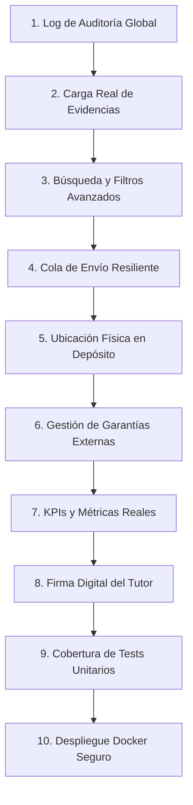

# Roadmap de Avances del Proyecto: MiCompuEdu_sj

Este documento detalla el plan estratégico de 10 pasos para evolucionar la plataforma **MiCompuEdu_sj** a su versión productiva definitiva, garantizando escalabilidad, rendimiento óptimo, seguridad física/lógica y una experiencia de usuario de nivel premium.

---

## Plan de Avances de 10 Pasos

### Paso 1: Sistema de Auditoría y Log Global (Audit Log)
- **Objetivo**: Registrar de forma inmutable cada cambio en las tablas críticas del sistema.
- **Backend**: Implementar lógica automática en `ApplicationDbContext.SaveChangesAsync` para detectar operaciones de inserción, actualización y borrado. Escribir los estados anteriores y nuevos en formato `JSONB` en la tabla `audit_log` vinculándolo al `UsuarioId` del JWT.
- **Frontend**: Crear un visor básico para administradores que permita auditar la trazabilidad de cualquier orden.

### Paso 2: Subida Real de Evidencias de Reparación
- **Objetivo**: Permitir a los técnicos documentar visualmente el estado físico del hardware (pantallas trizadas, humedad, etc.).
- **Backend**: Crear un endpoint `/api/v1/evidencias/upload` de tipo multipart form. Configurar almacenamiento en disco local (ej. carpeta `wwwroot/uploads/evidencias/`) o en un bucket compatible. Registrar la URL física y nombre del archivo en la tabla `evidencias_reparacion`.
- **Frontend**: Reemplazar la simulación del panel técnico por un componente dropzone que permita subir y eliminar fotos reales tomadas desde la cámara del celular o PC.

### Paso 3: Motor de Búsqueda y Filtros Avanzados de Reparaciones
- **Objetivo**: Facilitar la localización rápida de equipos en la cola de trabajo del depósito.
- **Backend**: Optimizar `GetReparacionesQuery` con filtros lógicos opcionales: `EscuelaId`, `ProgramaEducativoId`, `TecnicoAsignadoId`, `FallaCatalogoId`, y rangos de fechas de ingreso.
- **Frontend**: Diseñar un panel lateral colapsable de filtros avanzados en la cola de reparaciones, implementando autocompletado y dropdowns dinámicos.

### Paso 4: Cola de Notificaciones Resiliente (Worker en Segundo Plano)
- **Objetivo**: Asegurar el envío de notificaciones de WhatsApp reduciendo la latencia de la API principal.
- **Backend**: Migrar el envío de notificaciones de WhatsApp síncrono a una cola procesada asíncronamente. Crear un `BackgroundService` (.NET Worker) que consulte periódicamente la tabla `notificaciones` para despachar registros `Pendientes`. Implementar políticas de reintento exponencial (exponential backoff) para envíos fallidos.

### Paso 5: Gestión de Ubicación Física en Depósito (Estanterías)
- **Objetivo**: Reducir los tiempos de búsqueda física de las computadoras dentro del depósito central.
- **Base de Datos**: Implementar la tabla `ubicaciones_deposito` (ej. Estantería A, Fila 3, Posición 12).
- **Backend/Frontend**: Al registrar el ingreso de la notebook (Operador), poder asignarle un código de ubicación de depósito. Mostrar esta ubicación física en el Panel Técnico y en la pantalla de Entrega.

### Paso 6: Módulo de Gestión de Garantías Externas y Derivación
- **Objetivo**: Trazar el ciclo de vida de los equipos que deben salir del taller ministerial hacia servicios técnicos de fabricantes (EXO, BGH) o laboratorios de terceros.
- **Backend**: Agregar estados de transición en `EstadoEquipo` (`En_Garantia_Externa`, `Apartado_Para_Garantia`). Registrar información del proveedor de garantía, número de guía/remito de envío y fecha esperada de retorno.
- **Frontend**: Crear una sección para derivar equipos masivamente y generar remitos de salida en PDF.

### Paso 7: Consolidación de Métricas y KPIs del Dashboard (Supervisor)
- **Objetivo**: Ofrecer estadísticas y reportes reales de productividad y fallas recurrentes.
- **Backend**: Conectar `DashboardController` a queries de agregación de PostgreSQL. Calcular en tiempo real:
  - Tiempo promedio de resolución (diferencia en días entre fecha de ingreso y fecha de reparación).
  - Ranking de fallas más reportadas por escuela y programa.
  - Tasa de efectividad de reparados vs. no reparables.
- **Frontend**: Integrar librerías de gráficos interactivos (ej. Chart.js o Recharts) para representar las métricas con diseño estético premium.

### Paso 8: Firma Digital del Tutor en Recepción y Entrega
- **Objetivo**: Validar de manera legal y digital el ingreso y retiro físico de los equipos.
- **Frontend**: Integrar una caja de firma digital basada en Canvas HTML5 que permita al tutor firmar con el dedo (celular/tablet) o con el mouse (PC).
- **Backend**: Recibir la firma codificada en Base64, convertirla a imagen y guardarla adjunta a la orden. Plasmar la firma dentro de los PDFs de comprobante de ingreso y remito de entrega generados por `QuestPDF`.

### Paso 9: Suite de Pruebas Unitarias del Dominio y Casos de Uso
- **Objetivo**: Blindar el código contra regresiones de software durante futuras actualizaciones.
- **Pruebas**: Crear un proyecto de pruebas unitarias `MiCompuEdu.UnitTests` usando **xUnit** y **FluentAssertions**. Desarrollar tests para:
  - Lógica de parseo del código de barras DNI PDF417 (casos de borde con nombres compuestos, espacios y caracteres especiales).
  - Validaciones de transiciones de estados válidas en el flujo del taller.
  - Lógica de expiración y permisos de los roles JWT.

### Paso 10: Despliegue Docker Seguro y Nginx Inverso con SSL
- **Objetivo**: Asegurar el despliegue del sistema completo de forma segura e idéntica en cualquier servidor del Ministerio.
- **Configuración**:
  - Optimizar `docker-compose.yml` para producción.
  - Asegurar la contraseña de PostgreSQL mediante secrets de Docker.
  - Configurar volúmenes persistentes aislados para evidencias de imágenes, comprobantes PDFs y base de datos.
  - Configurar Nginx para forzar tráfico HTTPS con certificados Let's Encrypt / SSL institucionales.
