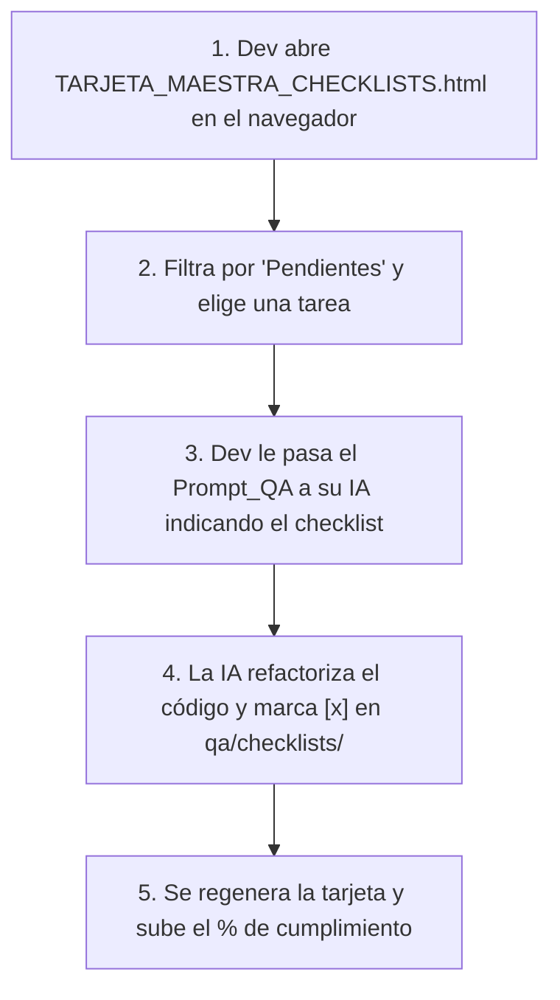

# 🤖 Guía y Prompt de QA para el Equipo de Desarrollo

Este documento está diseñado para que los desarrolladores y sus asistentes de Inteligencia Artificial (Cursor, Claude Code, GitHub Copilot, Gemini, etc.) sepan exactamente cómo trabajar con el sistema de calidad, auditar y resolver los puntos pendientes.

---

## 💡 ¿Cómo se complementan la Tarjeta HTML y los Checklists Markdown?

* **Para el Desarrollador (Humano):**
  Abrí con doble clic en tu navegador [**`qa/informes/generados/TARJETA_MAESTRA_CHECKLISTS.html`**](file:///b:/micompu/qa/informes/generados/TARJETA_MAESTRA_CHECKLISTS.html).
  Es tu **tablero visual interactivo**: podés filtrar por *"Pendientes"*, ver el avance en tiempo real y elegir qué área o punto querés abordar (ej. *01-Seguridad*, *02-Backend*, *03-Frontend*, etc.).

* **Para la Inteligencia Artificial (Agente de Código):**
  **Mandala a leer los archivos Markdown en [`qa/checklists/`](file:///b:/micompu/qa/checklists)** (`01-seguridad.md` a `10-documentacion.md`).
  Para un modelo de lenguaje, el Markdown es la fuente de verdad directa, rápida y sin ruido de diseño HTML. Además, la IA puede marcar con `[x]` los puntos a medida que los resuelva en el código.

---

## 📋 Prompt para pasarle a tu Asistente de IA

> **Instrucciones para el desarrollador:**  
> Copiá el bloque de abajo, completá el área o punto que elegiste en la tarjeta visual y pegáselo a tu IA en la raíz del proyecto.

```markdown
Actuá como desarrollador senior de este proyecto (MiCompuEdu_sj: .NET 8 Clean Architecture en backend, React 19 + TypeScript + Vite en frontend, y PostgreSQL con EF Core).

Tu objetivo es resolver los requerimientos técnicos de QA asignados.

### 1. FUENTE DE VERDAD
Leé el archivo de checklist correspondiente en `qa/checklists/`:
- Si trabajamos seguridad: `qa/checklists/01-seguridad.md`
- Si trabajamos backend: `qa/checklists/02-backend-dotnet.md`
- Si trabajamos frontend: `qa/checklists/03-frontend-react-vite.md`
- Si trabajamos base de datos: `qa/checklists/04-base-de-datos-efcore-postgres.md`
- Si trabajamos endpoints/API: `qa/checklists/05-api-y-swagger.md`
(o el checklist que te indique a continuación).

### 2. TAREA A RESOLVER
Quiero que resuelvas el/los siguiente(s) punto(s):
👉 [ESCRIBÍ ACÁ EL ÍTEM O PUNTOS QUE QUERÉS RESOLVER, O "Revisá todo el archivo 0X-..."]

### 3. REGLAS ESTRICTAS DE IMPLEMENTACIÓN
1. **No inventar ni romper compatibilidad:** Mantené el estilo de código del proyecto, la tipificación estricta y los contratos de API existentes.
2. **Clean Architecture en Backend:** Los controladores deben ser delgados (< 200 líneas). Nunca inyectar DbContext directamente en un Controller; toda consulta o mutación debe encapsularse en MediatR (Commands/Queries) o Services.
3. **Modularidad en Frontend:** Ninguna vista en `src/pages/` debe ser un monolito (> 500 líneas). Si agregás o refactorizás lógica extensa, extraé componentes en partials (`components/`) o custom hooks.
4. **Verificación:** Si modificás backend o frontend, asegurate de que no queden errores de compilación, referencias rotas ni fallos de tipado.

### 4. CIERRE Y ACTUALIZACIÓN
Una vez que el código esté corregido y verificado:
1. Mostrame un resumen conciso de los archivos modificados y la solución aplicada.
2. Editá el checklist en `qa/checklists/` cambiando `- [ ]` a `- [x]` únicamente en los ítems que hayan quedado 100% resueltos en el código.
```

---

## 🔄 Flujo de Trabajo Recomendado (Paso a Paso)



1. **Elegir:** El dev abre `TARJETA_MAESTRA_CHECKLISTS.html` y ve qué falta.
2. **Instruir:** Le pasa a su IA el prompt indicando el checklist de `qa/checklists/`.
3. **Resolver:** La IA aplica los cambios en el código real (backend o frontend) respetando las reglas arquitectónicas.
4. **Tildar:** La IA pasa el ítem a `- [x]` en el archivo Markdown correspondiente.
5. **Verificar avance:** Cada vez que se actualizan los checklists, la tarjeta ejecutiva refleja el nuevo porcentaje de éxito del equipo.
